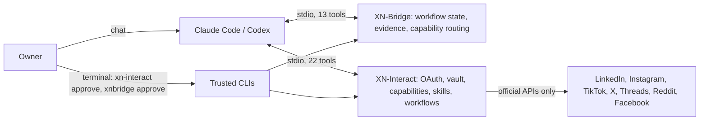

# XN-Interact implementation plan

XN-Interact is a Bun-native, MCP-only gateway that lets the owner operate the officially supported parts of seven social accounts (LinkedIn, Instagram, TikTok, X, Threads, Reddit, Facebook) through provider OAuth, with truthful capability checks, deterministic skills, durable workflows and human approval for every public or destructive action. XN-Bridge coordinates it with the owner's other MCP servers.

This plan turns the baseline specification into tracked, verifiable work. The plan data in `plan/` is machine-checked; this page explains it.

## Objective and success criteria

Release 1 is done when all of the following hold, each proven by the evidence named:

1. All 64 MUST requirements in `plan/requirements.json` are verified (every covering task `VERIFIED`).
2. At least one real provider passes auth → identity → read → approved write → verified read-back without mocks (P5-06).
3. The same real write succeeds when coordinated by XN-Bridge through the `social` domain, with both approvals consumed once and the provider URL stored as bridge evidence (PB-14).
4. Kill-and-restart during a write never duplicates it, in XN-Interact alone (P7-05) and across both servers (PB-13).
5. Claude Code and Codex list and call all 22 tools by their catalog names (P1-10, PB-03).
6. No credential appears in any MCP output, log, database plaintext or backup (canary suite, P2-05).
7. The token benchmark is published with fixtures and tokenizer version (P9-05).
8. The owner signs the launch checklist (P10-09).

Out of scope stays as in the baseline: no frontend, no internal LLM or agent, no browser automation fallback, no scraping, no remote multi-user deployment.

## System boundary



Neither server calls the other. The host runs XN-Interact tools and reports the results to XN-Bridge. XN-Interact enforces its own approval at the point where the provider call happens, because the host can always call it directly. Details: [xn-bridge-integration.md](xn-bridge-integration.md).

## Roadmap

| Order | Phase | Delivers | Exit gate |
|---:|---|---|---|
| 0 | P0 Evidence and foundations | Consistency review, plan and checker, bridge contract, Bun/MCP/host spikes, seven provider evidence rows, threat model, first-provider choice | SEC-05; P0-15, P0-17 |
| 1 | P1 Bun MCP kernel | stdio server, 22-tool registry from the catalog, envelopes, profiles, resources/prompts skeleton, host smoke | CORE-03/04/05/09/11/12, PERF-02; P1-10 |
| 2 | P2 Persistence and security | SQLite + migrations, vault, fail-closed secrets, redaction, transport allowlist, sandbox, leases | SEC-01/06, AUTH-09/10, OPS-02/03, ROUTE-08 |
| 3 | P3 OAuth broker | Profiles, state + PKCE, callback listener, exchange, refresh, revoke, operator CLI | AUTH-01/03…08; P3-09 real round trip |
| 4 | P4 Capability and write-safety kernel | Manifests, truth function, cache, admission, plan builder, approval CLI, two-phase tools, intent journal | ROUTE-02/03/06, AUTH-11, PERF-04, FLOW-05/06/10 |
| 5 | P5 First vertical slice | Selected provider end to end | ROUTE-04/05/07, FLOW-03; P5-06 without mocks |
| 6 | P6 Routing and skills | Tool router, 14 gateway skills, 9 workflow manifests, full resources, prompts | SKILL-01…05, CORE-06/10, ROUTE-10, SEC-04 |
| 7 | P7 Workflow engine | State machine, fan-out, reconciliation, recovery, cancellation, scheduler | FLOW-01/02/04/07/11 |
| 8 | PB XN-Bridge integration | Host registration, bridge capabilities, risk rules, social domain, routing, approval interplay, end to end | INT-01…07, INT-09; PB-14 |
| 9 | P8 Remaining adapters | Each provider verified independently; coverage report | ROUTE-01; P8-09 |
| 10 | P9 Token tuning | Success-normalized benchmark of 14/22/31 variants | PERF-03; P9-05 |
| 11 | P10 Hardening and release 1 | Threat-model tests, drift detection, retention, launch checklist | all MUST; P10-09 |

Order constrains dependency direction, not start time. A task starts when its own dependencies are verified, so provider evidence (P0-07…13), kernel work (P1) and security primitives (P2) run in parallel. A slow provider review never blocks the other providers: its operations stay `APP_APPROVAL_REQUIRED` and work continues elsewhere.

PB sits before P8 on purpose: the bridge integration is proven with the first provider and every later adapter inherits it, because XN-Bridge capabilities are provider-agnostic.

## Owner-only steps

These cannot be done by an agent and appear as `owner` or `owner+agent` tasks with `approval: true`:

- Sign off each provider evidence row (P0-07…13) and choose the first provider (P0-15).
- Register developer apps in provider consoles and keep their secrets out of chat and files (P0-16).
- Consent in the browser during OAuth and approve every real test write in the terminal (P3-09, P5-06, PB-14, P8-01…07).
- Approve host configuration changes: Claude Code user scope, Codex config, skill links, optional systemd unit (PB-03, P7-07).
- Approve XN-Bridge contract acceptance and the autonomy-scope change (PB-06, PB-11).
- Ask for commits (P0-18) and sign the release (P10-09).

## How tracking works

```bash
bun run plan                 # status board per phase
bun run plan next            # tasks whose dependencies are verified
bun run plan show P1-04      # detail, requirements, history
bun run plan set P1-04 IN_PROGRESS
bun run plan set P1-04 VERIFIED --evidence tests/contract/registry.test.ts --note "22 tools equal catalog"
bun run plan:check           # consistency check, non-zero exit on errors
bun test tests/plan          # checker and its negative tests
```

Task states follow the structured-project-execution state machine:

```
PLAN → IN_PROGRESS → VERIFIED
         ↓   ↑
       BLOCKED ⇄ APPROVAL_REQUESTED → APPROVED → IN_PROGRESS | VERIFIED
any → ARCHIVED (discontinued, never relaunched)
```

Rules the checker and `plan set` enforce:

- `plan set` validates the transition, appends a checkpoint to `plan/checkpoints.jsonl`, rewrites `plan/tasks.json` and re-renders `docs/plan/STATUS.md`. If the result would be inconsistent, nothing is written.
- A task can be active only after all its dependencies are `VERIFIED`. `VERIFIED` needs evidence; for repository tasks every listed deliverable must exist.
- Only the owner can approve, and only at an interactive terminal. An approval-gated task cannot be verified without an `APPROVED` checkpoint.
- `BLOCKED` needs a blocker. Approval-gated and host tasks need a rollback.
- `tasks.json` and the checkpoint log must agree; `STATUS.md` must equal its rendering.
- Phase state is derived, never stored: `DONE` when every task is verified and the gate holds.

The checker also validates the design itself: 22 tools with snake_case names, risk equal to their operations, two-phase external writes, no direct external writes, approval gate + intent journal + reconcile around every external write, total and unambiguous skill routes, one error code per non-available capability state, encrypted columns on secret tables, provider evidence that cannot claim `VERIFIED` without proof, and an XN-Bridge mapping whose risk rules equal the catalog with a fail-closed default.

## Files

| Path | Holds |
|---|---|
| `plan/catalog.json` | Canonical contract: operations, 22 tools, 14 gateway skills, skill routes, 9 workflows, enums, error codes, resources, prompts, tables |
| `plan/requirements.json` | 79 requirements (64 MUST, 14 SHOULD, 1 COULD) with source and verification method |
| `plan/phases.json` | 12 phases with order, gates and default rollback |
| `plan/tasks.json` | 122 tasks with dependencies, requirements, deliverables, verification, approval and rollback |
| `plan/providers.json` | Stage-0 evidence rows for seven providers and the ten known source conflicts |
| `plan/bridge.json` | XN-Bridge contract: capabilities, risk rules, outcome map, approval and evidence conventions, social domain, routing |
| `plan/checkpoints.jsonl` | Append-only state transitions |
| `docs/plan/STATUS.md` | Generated status |
| `docs/plan/consistency-review.md` | CR-01…CR-33 resolutions |
| `docs/plan/xn-bridge-integration.md` | Integration contract |
| `docs/adr/README.md` | ADR index |
