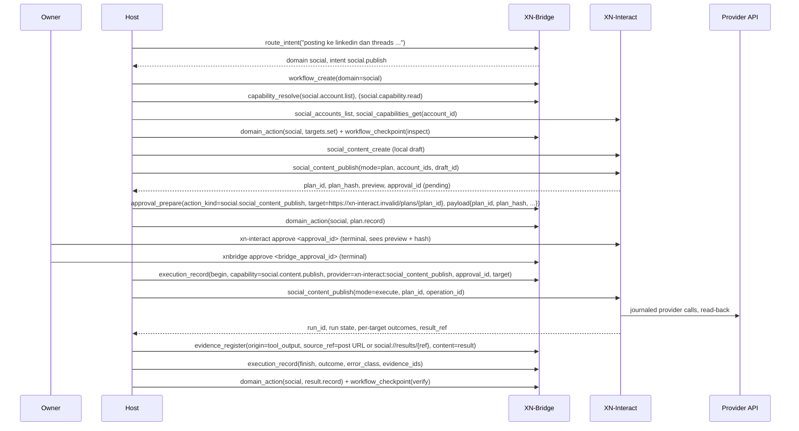

# XN-Interact ↔ XN-Bridge integration contract

Machine-readable source: `plan/bridge.json`, validated by `bun run plan:check` against `plan/catalog.json`. Observed XN-Bridge behaviour comes from its source on 2026-11-19 (`server.py`, `executions.py`, `security.py`, `approval.py`, `defaults/*.toml`, `AGENTS.md`).

## Activation status (2026-11-19)

| Item | State |
|---|---|
| `xn-interact` in XN-Bridge `.mcp.json`; `xn-social` linked for Claude Code and Codex in the XN-Bridge workspace | done (backups in `.cache/xn-bridge-backup/`, rollback in [host-registration.md](../integration/host-registration.md)) |
| Discovery in the live bridge home | `xn-interact` OK, 22 tools, protocol 2025-11-25 |
| `capability_resolve` for all 20 `social.*` through the MCP fingerprint path | AVAILABLE, `xn-interact` selected |
| `social` domain, social routing, risk rules | live in XN-Bridge |
| Cross-server tests | fixture flow to COMPLETED and crash reconciliation pass (`tests/integration/bridge-e2e.test.ts`) |
| Claude Code approval of the project server | owner step (P1-10) |
| User-scope registration (Claude Code, Codex) | owner approval (PB-16) |
| Bridge autonomy scoped to career | owner approval (PB-11); social writes stay safe because XN-Interact requires its own approval |

## One dynamic router

`route_intent` answers for every domain and capability the bridge knows. Intents come from code (career, research), `defaults/intents.toml` (social) and `data/config/intents.toml` (local additions or `disabled = true`). When no intent matches and the text carries no domain vocabulary, a capability index over all capability ids, descriptions, `keywords` and provider tool names picks one, but only with an action word plus an object word and a clear lead; otherwise the host decides with the candidates attached. Each decision carries `providers` (selected `server:tool`, status, approval need), a `plan` of the next stages with their providers, and `next`. Dev set: 0 confident errors, accuracy 0.927; held-out: 0 confident errors, accuracy 0.55 (was 0.50).

## Roles

| Concern | Owner | Why |
|---|---|---|
| Interpreting the user's request, choosing tools | Host (Claude Code or Codex) | Neither server runs a model |
| Cross-tool workflow state, evidence ledger, capability selection | XN-Bridge | Already durable and audited; social becomes one more domain |
| Social OAuth, vault, provider calls, capability truth, per-target outcomes, social approvals | XN-Interact | It is the only process that touches provider APIs, so it is the only place that can enforce approval for them |
| Human approval of a social write | Owner at the terminal: `xn-interact approve` (authoritative) and `xnbridge approve` (bridge bookkeeping) | Approvals never come from tool arguments |

Invariants:

1. XN-Bridge never calls XN-Interact and XN-Interact never calls XN-Bridge. The host relays.
2. XN-Interact executes a social write only with its own granted, unconsumed, plan-hash-matching approval. A bridge approval or bridge unattended mode is never enough (INT-03).
3. Per-target truth (which accounts succeeded) lives in XN-Interact. XN-Bridge records one execution per XN-Interact plan and links the evidence.
4. Unknown outcomes are never retried by either server. Both reconcile: XN-Interact through `ops.recover`, XN-Bridge through `execution_record op=reconcile`.

## Publish through XN-Bridge

Read-only tasks (analytics, engagement review, search) use the same loop without the `act` stage and without approvals.

## Capabilities

Twenty `social.*` capabilities, each served by `xn-interact`. Every catalog tool appears in exactly one capability.

| Capability | Tools | Risk |
|---|---|---|
| `social.account.connect` | `social_auth_connect` | LOCAL_WRITE |
| `social.account.status` | `social_auth_status` | READ |
| `social.account.disconnect` | `social_auth_disconnect` | EXTERNAL_WRITE |
| `social.account.list` | `social_accounts_list` | READ |
| `social.capability.read` | `social_capabilities_get` | READ |
| `social.content.read` | `social_content_list`, `social_content_get` | READ |
| `social.content.draft` | `social_content_create` | LOCAL_WRITE |
| `social.content.publish` | `social_content_publish` | EXTERNAL_WRITE |
| `social.content.update` | `social_content_update` | EXTERNAL_WRITE |
| `social.content.delete` | `social_content_delete` | EXTERNAL_WRITE |
| `social.engagement.read` | `social_engagement_list` | READ |
| `social.engagement.act` | `social_engagement_execute` | EXTERNAL_WRITE |
| `social.search` | `social_search` | READ |
| `social.analytics.read` | `social_analytics_get` | READ |
| `social.media.stage` | `social_media_upload` | LOCAL_WRITE |
| `social.workflow.run` | `social_workflows_execute` | EXTERNAL_WRITE |
| `social.workflow.status` | `social_workflows_status`, `social_results_get` | READ |
| `social.workflow.cancel` | `social_workflows_cancel` | LOCAL_WRITE |
| `social.approval.status` | `social_approvals_status` | READ |
| `social.health` | `social_system_health` | READ |

Cost labels: `FREE_LOCAL` for tools that never call a provider, `PROVIDER_METERED` otherwise. XN-Bridge treats cost labels as unverified configuration; real costs are enforced by XN-Interact's cost admission (ROUTE-06).

Every capability has a `degraded` instruction that never invents results and never asks for passwords or tokens.

## Risk rules

XN-Bridge's classifier takes the first matching rule and falls back to `EXTERNAL_WRITE`. `plan/bridge.json` lists 22 exact rules equal to the catalog risks, then `xn-interact:*` → `EXTERNAL_WRITE` last, so a tool added later is treated as an external write until reviewed. The checker refuses any glob before the last rule.

## The `social` domain in XN-Bridge

| Stage | Required | Capabilities | Risk | Bridge action |
|---|---|---|---|---|
| connect | optional | account.connect, account.status | LOCAL_WRITE | — |
| inspect | required | account.list, capability.read (+ health) | READ | `targets.set` |
| collect | optional | content.read, engagement.read, search, analytics.read | READ | — |
| prepare | optional | content.draft, media.stage | LOCAL_WRITE | — |
| act | optional | content.publish/update/delete, engagement.act, workflow.run/cancel, account.disconnect, approval.status | EXTERNAL_WRITE | `plan.record` |
| verify | required | workflow.status (+ content.read, approval.status) | READ | `result.record` |

Bridge actions only store coordination records (`LOCAL_WRITE`) in XN-Bridge's generic entity table; they never touch a provider.

Routing (`route_intent`): career wins whenever a career term appears, so "cari lowongan magang di linkedin" stays a career request. Otherwise a social intent needs a provider or social-media term. The cases in `plan/bridge.json` are checked by a reference matcher here and must pass unchanged in XN-Bridge's own tests (PB-08).

## Approvals

Release 1 uses two gates on purpose:

| Gate | Binds | Granted by | Enforced where |
|---|---|---|---|
| XN-Interact approval | plan hash, operation, account set, content digest, expiry, one-time nonce | `xn-interact approve <id>` at a TTY | Inside XN-Interact before any provider call |
| XN-Bridge approval | workflow, `action_kind = social.<tool>`, target `https://xn-interact.invalid/plans/{plan_id}`, payload digest over `plan_id`, `plan_hash`, `operation`, `account_ids`, `content_digest`, `interact_approval_id`, `expires_at` | `xnbridge approve <id>` at a TTY | Inside XN-Bridge at `execution_record begin` |

Why the odd target: XN-Bridge requires an http(s) URL with a host (`origin_of`). `.invalid` is reserved by RFC 2606 and never resolves, and one target per plan makes bridge dedupe match XN-Interact's one-time approval. A changed plan gets a new `plan_id`, so both approvals must be requested again.

XN-Bridge autonomy: the owner enabled `unattended_external_writes` for career work. In code it applies to every capability. XN-Interact ignores it (INT-03), and PB-11 proposes an allowlist in XN-Bridge so `social.*` always requires the bridge approval too. That change needs the owner's approval because it touches the standing authorization mechanism.

Later option (INT-10, COULD): one human decision verifiable by both servers, for example XN-Interact verifying an XN-Bridge Ed25519 statement whose payload digest covers its plan hash. Only after a threat model (PB-15).

## Outcomes, errors and evidence

| XN-Interact run state | Bridge outcome | error_class |
|---|---|---|
| `succeeded` | SUCCEEDED | NONE |
| `partially_succeeded` | SUCCEEDED, `detail.partial=true` | NONE |
| `failed` | FAILED | the error code's `bridge_error_class` |
| `unsupported` | FAILED | MISSING_CAPABILITY |
| `unknown_outcome` | OUTCOME_UNKNOWN | UNKNOWN_SIDE_EFFECT |
| `cancelled` (nothing sent) | FAILED | ABORTED_BEFORE_SEND |

A partial result is recorded as SUCCEEDED because its side effects are known and evidenced; failed targets need a new plan and new approvals, never a replay. A cancelled run that already sent something is reported as `partially_succeeded`.

Every XN-Interact error code carries `bridge_error_class` (for example `MISSING_SCOPES` → `AUTH_REQUIRED`, `APP_APPROVAL_REQUIRED` → `PERMISSION_DENIED`, `RATE_LIMITED` → `PRECONDITION_FAILED`, `OUTCOME_UNKNOWN` → `UNKNOWN_SIDE_EFFECT`). The full table is `catalog.error_codes`.

Evidence: `origin = tool_output`; `source_ref` is the provider's canonical post URL when returned, else `social://results/{ref}`; `VERIFIED` only for captured XN-Interact output, summaries stay `INFERRED`.

## Registration

| Host | Change | Backup and rollback |
|---|---|---|
| Claude Code | `claude mcp add --scope user xn-interact -e XN_INTERACT_HOME=<home> -- bun run /home/misbahul45/code/XN-Interact/src/main.ts`; link `host-skills/xn-social` into `~/.claude/skills` | Copy `~/.claude.json` first; `claude mcp remove --scope user xn-interact`; remove the link |
| Codex | `[mcp_servers.xn-interact]` in `~/.codex/config.toml`; skill link under `.agents/skills` | Timestamped copy of `config.toml` first, as XN-Bridge did; restore or delete only that table |
| XN-Bridge | `xnbridge discover --via-host --only xn-interact`, review `catalog changed --server xn-interact`, `catalog accept --server xn-interact --tool <tool>` per reviewed tool | Leave contracts quarantined; remove the capability mappings |

During P1 the server is tested through a project-scope `.mcp.json` in this repository and a per-invocation Codex override, so no user-scope configuration changes until PB-03 is approved.

## Changes required in XN-Bridge

Following XN-Bridge's engineering rules (no code comments, commit only when asked):

| Task | File | Change |
|---|---|---|
| PB-04 | `src/xnbridge/defaults/capabilities.toml` | 20 `social.*` capabilities from `plan/bridge.json` |
| PB-05 | `src/xnbridge/defaults/policy.toml`, `tests/unit/test_social_risk.py` | 22 exact rules + fail-closed default, classifier test |
| PB-07 | `src/xnbridge/domains/social.py`, `tests/unit/test_social_domain.py` | `DomainSpec` with six stages and three actions |
| PB-08 | `src/xnbridge/routing.py`, `tests/unit/test_routing.py` | Social intents with career precedence |
| PB-11 | `src/xnbridge/executions.py`, `defaults/policy.toml` | Capability allowlist for unattended writes (owner approval) |
| PB-02 / PB-03 | XN-Bridge `AGENTS.md` "One owner per job" | Add `social.* → xn-interact` |

## Tests

| Requirement | Test |
|---|---|
| INT-01 | `capability_resolve` selects `xn-interact` for all 20 capabilities after acceptance (PB-06) |
| INT-02 | XN-Bridge classifier over 22 tools plus an unknown tool (PB-05); XN-Interact drift test (PB-01) |
| INT-03 | Execute with only a bridge approval, or with bridge autonomy on, returns `APPROVAL_REQUIRED` (PB-10) |
| INT-04 | Every error code and terminal state maps (P1-03, PB-09) |
| INT-05 | Routing cases incl. career guards (PB-08); domain stage tests (PB-07) |
| INT-06 | Fixture end to end (PB-12), real provider end to end (PB-14) |
| INT-07 | Changed plan invalidates both approvals (PB-10) |
| INT-09 | Both hosts list `xn-interact`; rollback rehearsed (PB-03) |
| INT-11 | Kill during execute; both servers agree after reconciliation (PB-13) |
